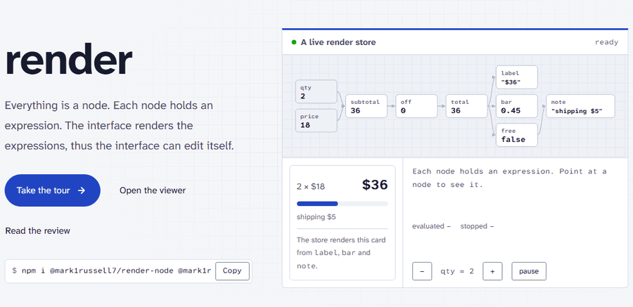

# render

[](https://www.npmjs.com/package/@mark1russell7/render-node)
[](https://github.com/mark1russell7/render/actions/workflows/ci.yml)
[](https://mark1russell7.github.io/render/)
[](./LICENSE)

**An interface that renders its own expressions.** render is a reactive expression engine for TypeScript. Each value is a node with an expression. One write starts one ordered epoch: the store evaluates each reader in topological order, and it stops where a value does not change. Classes are templates of nodes, stored as data, and the live viewer edits classes and instances in the same type graph.

<p align="center">
  <a href="https://mark1russell7.github.io/render/">
    <picture>
      <source media="(prefers-color-scheme: dark)" srcset="docs/media/hero-dark.gif" />
      
    </picture>
  </a>
</p>

[The site](https://mark1russell7.github.io/render/) has the guide, live demos of each idea, and [the viewer](https://mark1russell7.github.io/render/viewer/) in the browser.

## Install

```sh
npm i @mark1russell7/render-node @mark1russell7/render-dsl @mark1russell7/render-splay
```

```ts
import { app, lit, ref } from "@mark1russell7/render-dsl";
import { addNode, nodeStore, readValue, setValue } from "@mark1russell7/render-node";
import { standardOps } from "@mark1russell7/render-splay";

const store = nodeStore({ ops: standardOps });
addNode(store, lit(2), "w");
addNode(store, lit(4), "h");
addNode(store, app("*", ref("w"), ref("h")), "area");

readValue(store, "area"); // { tag: "some", value: 8 }
setValue(store, "w", 3);
readValue(store, "area"); // { tag: "some", value: 12 }
store.epochStats; // the nodes that the write evaluated and changed
```

## What is in it

- **Nodes and epochs.** A write makes its readers dirty, and one epoch evaluates them in topological order. A value that does not change stops the epoch on its path. A cycle evaluates again until its values are stable.
- **Expressions as data.** The IR has three node types: `lit`, `ref` and `app`. The interpreter is total: a failure gives `none` with a cause, and it does not throw. A formula syntax parses to the IR and back. The interchange form is a [coeval](https://github.com/mark1russell7/coeval) document, and each entry point that takes an expression also takes a document.
- **Classes as templates.** A class gives cells and methods. A change of a class reaches each instance that still follows it. Traits give methods by structure, with prime fingerprints.
- **An interface that renders itself.** Render methods are expressions. The viewer shows them as trees that a person can edit, and an edit changes the class at once. Each class can give a summary, thus a view shows the boundary of each thing first.

## Packages

Each package is ESM, has TypeScript declarations, and works in Node.js 22.12 or later and in browsers.

| Package | Contents |
| --- | --- |
| [`@mark1russell7/render-optional`](./packages/optional) | The `Optional` type of total evaluation: `none` or `some` |
| [`@mark1russell7/render-dsl`](./packages/dsl) | The expression IR (`lit`, `ref`, `app`), its static analysis, its interpreter, its formula language and its coeval documents |
| [`@mark1russell7/render-node`](./packages/node) | The reactive store: nodes, seats, slots, ordered epochs and the `NodeOps` extension points |
| [`@mark1russell7/render-biblo`](./packages/biblo) | The class registry, the instance store, the traits and the class-level `NodeOps` |
| [`@mark1russell7/render-splay`](./packages/splay) | Hydrate, splay and dehydrate, the level of detail, the standard classes and the standard ops |
| [`@mark1russell7/render-pack`](./packages/pack) | Rectangle packing for layouts |
| [`@mark1russell7/render-seat`](./packages/seat) | Reactive path subscriptions over plain values |
| [`@mark1russell7/render-viewer`](./packages/viewer) | The React viewer: the type graph and the canvas, with summaries, formulas, undo and saved sessions |

The workspace also has two private packages: [`@render/site`](./packages/site), the site with the live demos, and [`@render/cli`](./packages/cli), the workspace commands of the template.

## Quality

- Each known defect has an ID and a regression test that names it. [The review](https://mark1russell7.github.io/render/design/review/) shows the live status of each test.
- The browser tests run the viewer in Chromium, Firefox and WebKit, and on two phones.
- The package check installs each tarball in an empty project, runs it, and type-checks a strict consumer against its declarations.

## Commands

```sh
pnpm install
pnpm dev                              # the viewer, with the dev server of Vite
pnpm check                            # the type check, Oxlint, the coverage, the tests and ste-lint
pnpm test:e2e                         # the browser tests of the viewer (Playwright)
pnpm build                            # the npm build of each package (tsdown)
pnpm check:packages                   # pack, lint, install and run each package
pnpm bench                            # the speed lane (report only)
pnpm package add <name> --preset=ts   # make a new package
```

## Documents

- [`docs/REVIEW.md`](./docs/REVIEW.md): the review of October 2026, the plan of record
- [`docs/DECISIONS.md`](./docs/DECISIONS.md): the architecture decisions
- The site: <https://mark1russell7.github.io/render/>

## Writing style

The prose of this repository follows ASD-STE100 Simplified Technical English (STE). STE is a style target. ASD does not certify this repository. The project glossary is in `ste.config.json`. Keep a local copy of the STE dictionary in `.ste/`, and do not commit it.

## Disclosure

An AI model (Claude, from Anthropic) wrote most of the text and the code of this repository, under the direction of the author. The STEMG of ASD-STE100 asks for this disclosure in its white paper on STE and artificial intelligence (June 2026).
